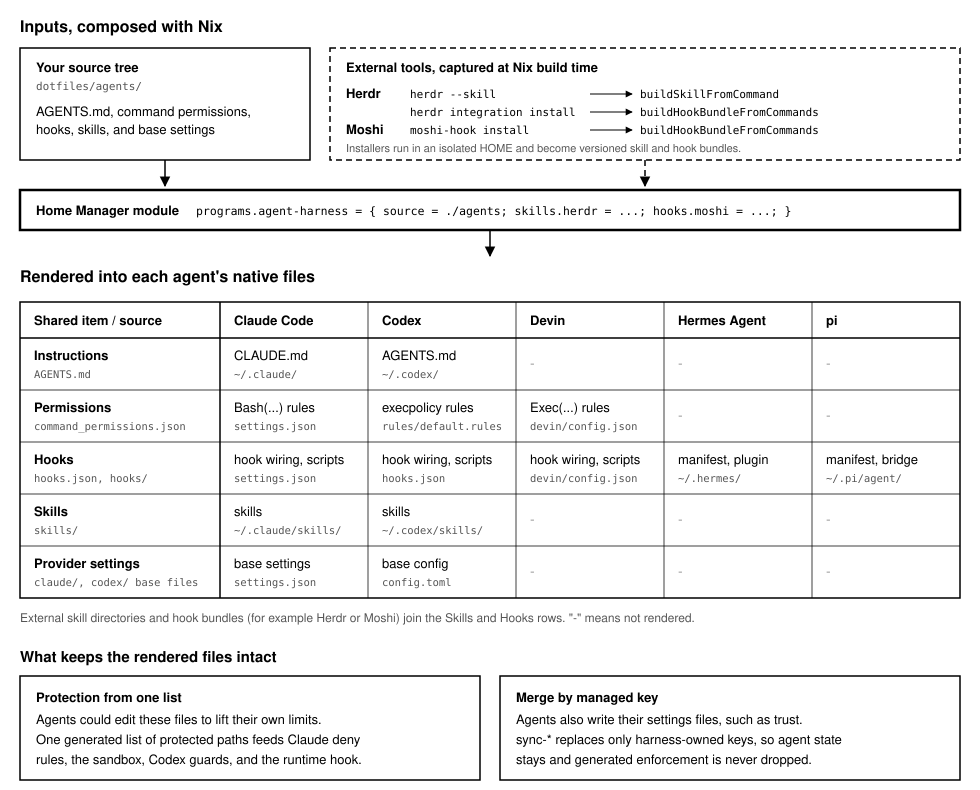

# Design

  
  

This document explains why agent-harness is shaped the way it is. The [README](../README.md) covers
installation and usage, and each decision links to its [Architecture Decision Record](adr/).

## Problem

Each coding agent reads its own configuration format. Claude Code uses `settings.json` permission
rules, Codex uses execpolicy rules and `config.toml`, Devin uses `Exec(...)` permissions, and Hermes
Agent and pi each load hooks through their own manifest and plugin. Writing these by hand for every
agent breaks in predictable ways:

- **Guardrails drift.** A command denied in Claude Code stays allowed in Codex because only one of
  the two files was updated. Nothing reports the difference.
- **Agents can rewrite their own guards.** Protection is enforced in several layers: permission
  rules, sandbox write denials, filesystem guards, and an explanatory hook. A path missing from any
  one list is writable. Before v0.9.2, the Devin, Hermes, and pi hook files and the mutable provider
  configs were missing from the protected set ([#140]).
- **Hooks are duplicated per agent.** The same check must be re-implemented against each agent's
  hook protocol, and the copies diverge.
- **Provider-owned state collides with managed settings.** Claude Code and Codex write to their own
  config files (project trust, saved approvals). Overwriting those files loses that state, while
  letting a settings overlay win can silently remove enforcement. A related bug dropped Claude-only
  source rules such as `Bash(dangerouslyDisableSandbox:true)` during generation ([#140]).

## Core decisions

**1. Render every agent's files from one neutral source.**

- Decision: a flat source tree (`AGENTS.md`, `command_permissions.json`, `hooks.json`, skills, base
  provider settings) is the only place a user edits. Generated files are never edited by hand.
- Reason: one `allow` / `ask` / `deny` rule set maps to Claude Bash permissions, Codex execpolicy
  decisions, and Devin `Exec(...)` rules, so a change cannot reach one agent and miss another.
- ADRs: [0012], [0014], [0015].

**2. Derive protected paths from one Rust inventory and fail closed.**

- Decision: the protection module computes the protected paths from the same tables the installer
  uses, then emits Claude deny rules, sandbox `denyWrite`, Codex guards, and a JSON policy that the
  runtime hook reads.
- Reason: enforcement layers cannot disagree when they share one generated list. If the policy file
  is missing or invalid, the hook blocks instead of allowing.
- ADRs: [0008].

**3. Keep Codex CLI conformance out of the required checks.**

- Decision: required CI tests the repository's own generation logic. A separate workflow checks
  generated execpolicy rules against the real Codex CLI, whose locked version Renovate keeps
  current.
- Reason: repository-owned tests stay the stable source of truth, and breakage caused by a Codex
  release is reported on its own instead of failing unrelated checks.
- ADRs: [0001].

**4. Compose external skills and hook bundles at install time.**

- Decision: callers pass skill directories and versioned hook bundles. Hook bundles are captured by
  running a tool's installer in an isolated temporary home, then merged structurally.
- Reason: upstream tools such as Herdr own their hook protocols. agent-harness stays the single
  config writer without vendoring their files or adding tool-specific code.
- ADRs: [0004], [0006].

**5. Own only managed keys in mutable provider configs.**

- Decision: sync commands replace harness-owned keys and preserve everything else. Source
  permission rules are kept, deduplicated, and a rule in several lists stays only in the most
  restrictive one.
- Reason: agents keep writing their own state, but a settings overlay must never weaken or remove
  generated enforcement.
- ADRs: [0016], [0018].

## Alternatives considered

| Question                                              | Rejected alternative                                                              | Why it was rejected                                                                                            |
| ----------------------------------------------------- | --------------------------------------------------------------------------------- | -------------------------------------------------------------------------------------------------------------- |
| Why not hand-written allow lists per agent?           | Separate provider lists, Bash path patterns in hooks                              | Lists drift between the hard boundary and the hook ([0008]).                                                   |
| Why not pin Codex CLI?                                | Pinning Codex in the dev shell, or adding it to required CI                       | Repository tests stay the source of truth, and Codex breakage is reported separately ([0001]).                 |
| Why not vendor Herdr's hooks?                         | Vendored copies (ADR-0002), then a Herdr-specific generator (ADR-0003)            | Vendored files went stale, and each new tool needed its own integration ([0006]).                              |
| Why not replace or deep-merge `settings.json`?        | Immutable symlink, recursive JSON merge, materializing all assets                 | Claude Code also writes the file; owning top-level keys keeps its state without weakening guardrails ([0016]). |
| Why not ship a personal profile?                      | An author-named built-in profile, or a mandatory profile repository               | Personal policy changes would force product releases ([0015]).                                                 |
| Why not put Claude-only rules in the neutral file?    | Provider syntax in `command_permissions.json`, stripping only prefix-shaped rules | The source Claude settings become the authoritative home for Claude-only rules ([0018]).                       |
| Why not infer project-local installs from `--prefix`? | Guessing the runtime scope from the output path                                   | Hooks assumed `$HOME` even when files were written elsewhere; an explicit root is self-contained ([0017]).     |

## Architecture

`install` renders into a staging directory first, then replaces only the managed files and
directories. `sync-*` commands merge managed keys into configs that agents also write.

| Module                                                                      | Responsibility                                                                 |
| --------------------------------------------------------------------------- | ------------------------------------------------------------------------------ |
| `cli`                                                                       | Parses subcommands and dispatches to rendering, sync, list, and verify.        |
| `source`, `layout`, `manifest`                                              | Resolve the source tree and validate its layout and required runtime commands. |
| `profile`                                                                   | Names the packaged built-in source (`minimal`).                                |
| `render`                                                                    | Stages a full installation, then replaces managed files and directories.       |
| `generation/hooks`, `generation/bridges`                                    | Render hook wiring and the Hermes plugin and pi bridge.                        |
| `generation/command_permissions`                                            | Maps neutral rules to Claude, Codex, and Devin permission syntax.              |
| `generation/claude_config`, `codex_config`, `devin_config`, `hermes_config` | Build and sync provider configs.                                               |
| `generation/protection`, `secret_path_policy`                               | Compute protected paths and secret-file deny rules.                            |
| `generation/skills`, `external_hooks`, `hook_bundle`                        | Render skills and compose external bundles.                                    |
| `inventory`                                                                 | Lists the skills and hooks a source provides.                                  |
| `runtime_root`                                                              | Relocates hook commands for project-local installs.                            |
| `runtime`                                                                   | Checks that the manifest's runtime commands are on `PATH`.                     |

## Verification

Figures below were measured on v0.9.2.

| Layer               | Location                                              | Count   |
| ------------------- | ----------------------------------------------------- | ------- |
| Unit tests          | `#[test]` in `src/`                                   | 77      |
| Integration tests   | `tests/*.rs`, running the built binary                | 36      |
| Codex conformance   | `tests/codex/execpolicy.bats`                         | 3 cases |
| Home Manager module | `tests/home_manager_module.nix` via `nix flake check` | 1 check |

The flake also builds the skill and hook-bundle builders as checks. GitHub Actions runs six
workflows:

- `ci`: Nix lint, clippy, rustfmt, `cargo test`, and dependency audits, gathered by an `all-green`
  job.
- `codex_conformance`: generated execpolicy rules against the locked Codex CLI, kept separate from
  `ci` by design ([0001]).
- `codeql`, `dependency_review`, `gha_lint`: security analysis and workflow linting.
- `release_please`: versioning, changelog, and cargo-dist release artifacts.

## Known limitations

- Release binaries are built only for `x86_64-unknown-linux-musl`. The Nix package and Home Manager
  module target only `aarch64-darwin`.
- The Home Manager `profile` option accepts only `minimal`. Other setups pass a complete `source`.
- `verify` checks required paths and runtime commands. It does not compare installed contents with
  the source.
- A key removed from generated Claude settings is not removed from an existing `settings.json`
  ([0016]).
- Approvals that Claude Code or Devin save interactively are replaced on the next sync. Persistent
  rules belong in the source.
- Skills are rendered but not protected.

## Changelog highlights

- **v0.7.0**: removed the Herdr-specific integration, leaving the generic hook bundles added in
  v0.6.0 as the only way to compose external hooks ([0006]).
- **v0.8.0**: split personal configuration out of the product, adopted flat source trees, and renamed
  command policy to command permissions ([0012], [0014], [0015]).
- **v0.9.2**: derived protected paths from every rendered provider file and kept source Claude
  permission rules during generation ([#140], [0018]).

[#140]: https://github.com/furedea/agent-harness/pull/140
[0001]: adr/0001_separate_codex_conformance_from_required_ci.md
[0004]: adr/0004_inject_external_skills_at_install_time.md
[0006]: adr/0006_compose_external_hook_bundles.md
[0008]: adr/0008_generate_runtime_protection_policy.md
[0012]: adr/0012_name_provider_neutral_command_permissions.md
[0014]: adr/0014_use_flat_profile_sources.md
[0015]: adr/0015_separate_personal_agent_source.md
[0016]: adr/0016_materialize_mutable_claude_settings.md
[0017]: adr/0017_separate_output_and_runtime_roots.md
[0018]: adr/0018_preserve_source_claude_permission_rules.md
