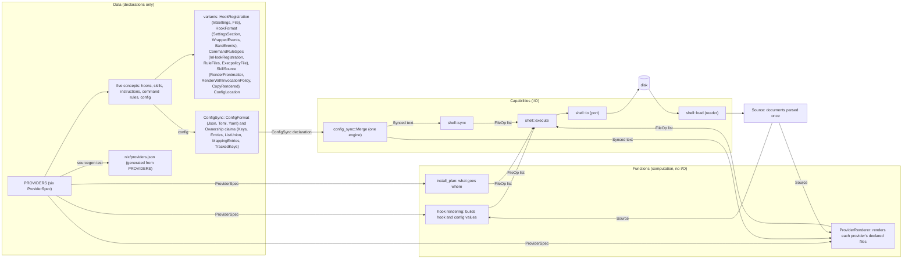
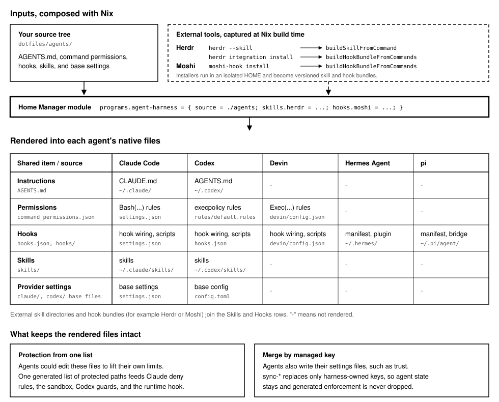
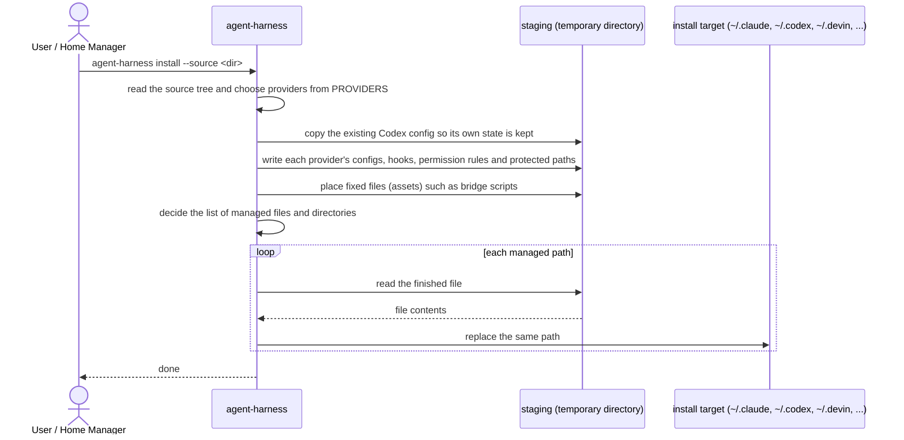

# 設計

  
  

この文書は，agent-harness がなぜ今の形をしているのかを説明する．インストールと使い方は [README](../README_ja.md) に，各設計判断の経緯は [Architecture Decision Record](adr/) にある．

## 問題

コーディングエージェントはそれぞれ独自の設定形式を読む．Claude Code は `settings.json` の権限ルール，Codex は execpolicy ルールと `config.toml`，Devin は `Exec(...)` 権限を使い，Hermes Agent と pi はそれぞれ独自の manifest とプラグインでフックを読み込む．これらをエージェントごとに手で書くと，決まった形で壊れる．

- **ガードレールがずれる．** 2 つのファイルの片方だけを更新したために，Claude Code で拒否したコマンドが Codex では許可されたままになる．その差を知らせるものはない．
- **エージェントが自分のガードを書き換えられる．** 保護は，権限ルール，サンドボックスの書き込み拒否，ファイルシステムのガード，説明用のフックという複数の層で行う．どれか 1 つのリストからパスが漏れると，そこは書き込める．v0.9.2 より前は，Devin，Hermes，pi のフックファイルと可変のプロバイダ設定が保護対象から漏れていた（[#140]）．
- **フックがエージェントごとに重複する．** 同じチェックを各エージェントのフックプロトコルに合わせて実装し直す必要があり，コピー同士が食い違っていく．
- **プロバイダが持つ状態と管理対象の設定がぶつかる．** Claude Code と Codex は，自分の設定ファイルにプロジェクトの信頼情報や保存した承認を書き込む．ファイルを上書きするとその状態が失われ，設定のオーバーレイを優先させると強制力が黙って外れることがある．関連するバグとして，生成時に `Bash(dangerouslyDisableSandbox:true)` のような Claude 専用のソースのルールが消えていた（[#140]）．

## 中核の設計判断

**1. すべてのエージェントのファイルを 1 つの中立なソースから生成する．**

- 決定：フラットなソースツリー（`AGENTS.md`，`command_permissions.json`，`hooks.json`，スキル，プロバイダのベース設定）だけをユーザーが編集する．生成したファイルは手で編集しない．
- 理由：1 つの `allow` / `ask` / `deny` のルールセットを，Claude の Bash 権限，Codex の execpolicy の判定，Devin の `Exec(...)` ルールに対応させる．そのため，変更があるエージェントにだけ届いて他に漏れることがない．
- ADR: [0012]，[0014]，[0015]．

**2. 保護パスを Rust の 1 つのインベントリから導出し，安全側に倒す．**

- 決定：protection モジュールが，インストーラと同じ表から保護パスを計算する．そこから，Claude の deny ルール，サンドボックスの `denyWrite`，Codex のガード，実行時のフックが読む JSON ポリシーを生成する．
- 理由：強制の各層が同じ生成済みのリストを共有すれば，食い違いは起きない．ポリシーファイルがないか不正な場合，フックは許可せずに拒否する．
- ADR: [0008]．

**3. Codex CLI への適合テストを必須チェックから外す．**

- 決定：必須の CI は，このリポジトリ自身の生成ロジックをテストする．別のワークフローが，生成した execpolicy ルールを実際の Codex CLI で確認する．その Codex のバージョンは lock ファイルで固定し，Renovate が更新し続ける．
- 理由：リポジトリが所有するテストを安定した正の基準に保ち，Codex のリリースが原因の破損は，無関係なチェックを落とさずに単独で報告する．
- ADR: [0001]．

**4. 外部のスキルとフックバンドルはインストール時に合成する．**

- 決定：呼び出し側が，スキルのディレクトリとバージョン付きのフックバンドルを渡す．フックバンドルは，ツールのインストーラを隔離した一時ホームで実行して取り込み，構造的にマージする．
- 理由：Herdr のような上流のツールは自分のフックプロトコルを所有している．agent-harness は，それらのファイルを vendoring したりツール専用のコードを足したりせずに，唯一の設定の書き手であり続ける．
- ADR: [0004]，[0006]．

**5. 可変のプロバイダ設定では，管理対象のキーだけを所有する．**

- 決定：同期コマンドは harness が所有する範囲を置き換え，それ以外は残す．所有範囲は各プロバイダが spec に宣言する（トップレベルのキー，接頭辞に合う配列の要素，和集合を取る配列，マッピングの項目，sidecar で追跡するキー）．1 つの同期処理が，宣言を JSON，TOML，YAML のどれにも適用する．ソースの権限ルールは残して重複を除き，複数のリストにあるルールは最も厳しいリストにだけ残す．オプトインのエージェント用 GitHub トークンだけは，ソースのサンドボックス除外を上書きする．
- 理由：エージェントは自分の状態を書き込み続けるが，設定のオーバーレイが生成した強制力を弱めたり取り除いたりしてはならない．
- ADR: [0016]，[0018]，[0020]，[0029]．

**6. プロバイダの宣言と処理，I/O を分離する．**

- 判断：Claude，Codex，Devin，Hermes，pi，dsh の 6 つすべてを `ProviderSpec` に宣言し，Data / Functions / Capabilities に分ける．すべてのフィールドは，多くの provider が共有する 5 つの概念のどれかに属する．hook（`HookSpec`：スクリプト，登録先，ブリッジファイル），skill，instructions，コマンドルール，config（`ConfigSpec`：パス，生成のしかた，所有範囲を宣言する `ConfigSync`）である．hook はすべての provider が持つので必須とし，ほかの概念は `Option` にする．provider ごとの違いは，その provider だけのフィールドではなく enum の variant で表す．
- 理由：パス，資産の出力先，同期の宣言を共有して一覧のずれを防ぎ，`HookRegistration` や `CommandRuleSpec` などの variant で違いを見える形にして網羅的に match する．一覧の並びは registry の順序に従う．Rust を唯一の source とし，`nix/providers.json` はそこから生成する．コミット済みのファイルと差があるとテストが失敗し，`UPDATE_PROVIDERS_JSON=1` で再生成できる．Home Manager は管理対象のファイルとサブディレクトリを明示してリンクする．
- ADR: [0026]，[0027]，[0028]，[0029]．

- 層をまたぐのは値だけである．`ProviderSpec` が Data から Functions と Capabilities へ渡り，loader が境界で組み立てた型付きの `Source` が loader から Functions へ渡り，`FileOp` の一覧が生成，レンダリング，計画，同期から唯一の書き込み口である executor へ渡る（[0028]）．
- 計算の層が書き込めないことを，1 つの crate の中で 3 つの仕組みで保証する．`clippy.toml` が `std` の書き込み API を禁止し，`shell::io` だけが禁止を外す．ポートは `pub(in crate::shell)` なので，計算の層は自前のラッパー経由でも到達できない．`generation`，`provider::spec`，`provider::renderer`，`install_plan`，`file_op`，`source_model`，`layout`，`manifest`，`inventory`，`render` の `#![forbid(...)]` が，禁止を再び許可することを防ぐ．crate の分割は採らなかった．`std::fs` はどの crate からも呼べるので clippy の禁止は結局必要で，分割で置き換わるのは可視性だけだからである（[0028]）．テストは検査の対象外である．
- 同じ禁止が読み込みにも及ぶ．結果は与えられた入力だけで決まり，実行した瞬間のディスクには左右されない．`shell::load` が source，外部 bundle，インストール済みの設定を一度だけ型付きの `Source` に読み込む．文書はすべて境界で解析と検証を済ませ，失敗はそのファイルのパスとともに境界で出る．丸ごとコピーするだけのディレクトリは場所とファイル一覧だけを持つ．計算は `Source` だけを読む．禁止するのは `std::fs` の読み込み，`Path` の `exists`／`is_dir`／`read_dir`／`metadata`，`std::env`，`std::process::Command` である．プログラムの命令的な端である `cli`，`source`，`runtime`，`github_app`，`shell::load`，`shell::hook_bundle`，ビルドスクリプトは，理由を添えた `#![expect(...)]` で自分だけ禁止を外す．不要になると `expect` がコンパイルエラーになる（[0028]）．
- 秘密のファイル（GitHub App のトークン）だけを `0600` で書く．それ以外はプロセスの既定のモードで書き，コピーは元のファイルの権限ビットを保ち，既存のファイルを置き換えるときはその権限ビットを保つ．
- Claude と Codex も他の 4 つと同じく registry に宣言する．registry は各 provider が持つものを宣言し，中身は provider ごとの関数が生成する（[0027]）．

## 検討した代替案

| 問い                                                                     | 退けた案                                                                                  | 退けた理由                                                                                                                 |
| ------------------------------------------------------------------------ | ----------------------------------------------------------------------------------------- | -------------------------------------------------------------------------------------------------------------------------- |
| エージェントごとに許可リストを手書きしないのはなぜか                     | プロバイダごとのリスト，フック内の Bash のパスパターン                                    | ハードな境界とフックの間でリストがずれる（[0008]）．                                                                       |
| Codex CLI を固定しないのはなぜか                                         | 開発シェルで Codex を固定する，必須 CI に含める                                           | リポジトリのテストを正の基準に保ち，Codex の破損は別に報告する（[0001]）．                                                 |
| Herdr のフックを vendoring しないのはなぜか                              | vendoring したコピー（ADR-0002），次に Herdr 専用のジェネレータ（ADR-0003）               | vendoring したファイルが古くなり，新しいツールのたびに専用の連携が必要になった（[0006]）．                                 |
| `settings.json` を置き換えるか深くマージしないのはなぜか                 | 不変のシンボリックリンク，再帰的な JSON マージ，すべての資産の実体化                      | Claude Code もこのファイルに書き込む．トップレベルのキーを所有すれば，その状態を残しつつガードレールを弱めない（[0016]）． |
| 個人のプロファイルを同梱しないのはなぜか                                 | 作者名の組み込みプロファイル，必須のプロファイル用リポジトリ                              | 個人のポリシー変更のたびに製品のリリースが必要になる（[0015]）．                                                           |
| Claude 専用のルールを中立なファイルに書かないのはなぜか                  | `command_permissions.json` にプロバイダの構文を入れる，プレフィックス形のルールだけを除く | ソースの Claude 設定を Claude 専用ルールの正式な置き場所にする（[0018]）．                                                 |
| プロジェクトローカルのインストールを `--prefix` から推測しないのはなぜか | 出力先のパスから実行時のスコープを推測する                                                | ファイルを別の場所に書いてもフックが `$HOME` を前提にしていた．明示した実行時ルートなら自己完結する（[0017]）．            |
| 計算の層を別の crate に分けないのはなぜか                                | I/O を持たない core crate を含む workspace                                                | `std::fs` はどの crate からも呼べるので clippy の禁止は結局必要で，分割で置き換わるのは可視性だけである（[0028]）．        |

## アーキテクチャ

- ステージング用のディレクトリは組み立て場所であり，生成中に失敗してもインストール先には触れない．
- ループでは，管理対象のパスごとに，ステージングで完成したファイルを読んで置き換える．
- エージェントが自分で書いた状態など，管理対象でないファイルはそのまま残す．

`sync-config --provider <id>` コマンドは，エージェントも書き込む設定ファイルに管理対象のキーをマージする．

| モジュール                                                                                | 責務                                                                                          |
| ----------------------------------------------------------------------------------------- | --------------------------------------------------------------------------------------------- |
| `cli`                                                                                     | サブコマンドを解析し，生成，同期，一覧，検証に振り分ける．                                    |
| `source`，`layout`，`manifest`                                                            | ソースツリーを解決し，そのレイアウトと必要な実行時コマンドを検証する．                        |
| `profile`                                                                                 | 同梱の組み込みソース（`minimal`）の名前を定める．                                             |
| `render`                                                                                  | ステージング生成を実行し，公開計画を executor に渡す．                                        |
| `provider/spec`，`provider/ownership`，`provider/registry`                                | Data: プロバイダのメタデータ，資産の出力先，`ConfigSync` の所有範囲の宣言，registry．         |
| `config_sync`（`codec`，`engine`，`installed`）                                           | Functions: 形式の codec，宣言された所有範囲を適用する唯一の処理，解析済みの `Installed`．     |
| `install_plan`                                                                            | Functions: 生成済み staging の公開と埋め込み資産の配置を計画する．                            |
| `shell`（`io`，`load`，`executor`，`sync`，`hook_bundle`）                                | Capabilities: ファイル I/O のポート，`Source` の loader，`FileOp` の executor，設定同期，hook bundle． |
| `source_model`                                                                            | Functions: 計算が読む型付きの `Source`（フック設定，権限規則，スキル，設定，bundle）．         |
| `nix/providers.json`，`nix/home_manager_module.nix`                                       | registry から生成する Nix の一覧と，そこから作る Home Manager の option，リンク，同期．       |
| `generation/hooks`                                                                        | フックの配線を描画する．                                                                      |
| `generation/bridges`，`provider/spec`，`install_plan`                                     | ブリッジ asset の契約を検証し，spec の埋め込み asset と出力先から書き込みを計画する．         |
| `generation/command_permissions`                                                          | 中立なルールを Claude，Codex，Devin の権限の構文に対応させる．                                |
| `generation/claude_config`，`codex_config`，`dsh_config`                                  | プロバイダの設定と，dsh の bundle 登録を組み立てる．                                          |
| `generation/protection`，`secret_path_policy`                                             | 保護パスと，秘密ファイルの deny ルールを計算する．                                            |
| `generation/guarded_path`，`guarded_conflict`                                             | Codex のガード用エントリを比べ，厳しいエントリの下に緩いエントリがあれば生成を失敗させる．    |
| `generation/skills`，`external_hooks`，`hook_bundle`                                      | スキルを生成し，外部のバンドルを合成する．                                                    |
| `inventory`                                                                               | ソースが提供するスキルとフックを一覧にする．                                                  |
| `runtime_root`                                                                            | プロジェクトローカルのインストール向けにフックのコマンドを移し替える．                        |
| `github_app`                                                                              | エージェント用トークンのために GitHub App のインストールトークンを発行する（[0021]）．        |
| `runtime`                                                                                 | manifest の実行時コマンドが `PATH` にあるかを確認する．                                       |

### Codex のガード用ファイルシステム

秘密パスのポリシーは，Codex には `[permissions.guarded.filesystem]` のエントリとして渡す．読み取りを禁止するルールは `"none"` にする．書き込みのみを禁止するルールは，Codex には一切出さない．Codex のファイルシステム権限はエージェントが起動するすべてのプロセスに効くのに対し，Claude の `Edit(...)` の deny は Edit ツールにしか効かない．書き込みのみのルールが守るのは，ハーネスのスクリプト自身が書き込む状態である（`verification_session.py` は `**/agent-harness/{verification,trusted-owners,audit}/**` に書く）．Codex のサンドボックスでこれらの書き込みを禁止すると，スクリプトが壊れる．これらはフックが引き続き強制する．Claude Code のサンドボックスが，こうしたパスの読み取りは禁止し，`~/.local/state/agent-harness` への書き込みは許すのと同じ扱いである．

Codex はより具体的なエントリを優先するため，厳しいエントリの下に緩いエントリがある（`~/.codex/** = "none"` の下の保護パス `~/.codex/hooks/adapt.sh = "read"`）と，禁止したパスが開く．ハーネスはどちらの意図かを推測してエントリを書き換えない．生成されたエントリどうしと，ソースの `codex/config.toml` との組を比べ，厳しいエントリが緩いエントリを覆うときは，両方のエントリを示して失敗する．パスは，祖先すべてではなく，それを覆う最も近いエントリで解決する．そのため，`:root = "deny"` の下の `~ = "write"` のような，間にある緩いエントリは，その下のエントリへの例外になる．パターンを持てるのは禁止だけで，緩いエントリは常に具体的なパスなので，グロブどうしは比べない（別のグロブより緩いグロブは検出できない）．読み取りを禁止するルールが波括弧のパターンを持つときは，Codex が波括弧を展開しないため，生成を失敗させる．パスはルートごとに比べる．`~`，絶対パス，UNC パス，ワークスペースは別のルートである．ただしプロジェクト内インストール（`--runtime-root` がプロジェクト）では，プロジェクト内の絶対パスを `:workspace_roots` とも照合する．Windows 形式のパス（ドライブ文字，UNC，または Windows ホスト上のすべてのパス）は `\` を区切りとし，大文字と小文字を区別せずに比べる．それ以外では `\` はファイル名の文字である．競合検出は安全網であり，秘密ポリシーはフックが実行時に強制する．

未読のグロブを事前展開するプラットフォームでは，Codex が `**` を `glob_scan_max_depth`（5）で打ち切る．そのため，それより深い秘密ファイルは，フックを通らないコマンドからは読めてしまう．フック時の検査が主たる防御である．

## 検証

以下の数値は v0.9.2 で計測した．

| 層                      | 場所                                                                                             | 数         |
| ----------------------- | ------------------------------------------------------------------------------------------------ | ---------- |
| ユニットテスト          | `src/` の `#[test]`                                                                              | 77         |
| 統合テスト              | `tests/*.rs`（ビルドしたバイナリを実行する）                                                     | 36         |
| Codex への適合          | `tests/codex/execpolicy.bats`                                                                    | 3 ケース   |
| Home Manager モジュール | `nix flake check` で実行する `tests/home_manager_module.nix`，`tests/home_manager_pure_eval.nix` | 2 チェック |

flake は，スキルとフックバンドルのビルダーもチェックとしてビルドする．モジュールは評価時に読むファイル（`settings.json`，`config.toml`，`secret_path_policy.json`，`profiles/`）をすべて `source.tree` から読み，`tree` がなければ `source` を読む．ビルド済みの `source` はビルド時にコピーするファイルの供給だけに使うので，評価でビルドは起きず，import-from-derivation は使わない（[furedea/agent-harness#196](https://github.com/furedea/agent-harness/issues/196)）．共有の `nix-check` ワークフローは，import-from-derivation を禁止して `nix flake check --all-systems` を実行する．GitHub Actions では 3 本のワークフローが動く．

- `ci`: clippy，rustfmt，`cargo test`，Rust の依存関係の監査に加え，`furedea/reusable-workflows` の共有ワークフロー（`nix-lint`，`nix-check`，`gha-lint`，`dependency-review`，`claude-review`，`codex-review`）を呼び出し，`all-green` ジョブで集約する．
- `codex-conformance`: 生成した execpolicy ルールを固定した Codex CLI で確認する．設計上 `ci` から分けている（[0001]）．
- `release`: 共有の `release-pr` と `release-publish` ワークフローでバージョン管理と変更履歴を扱い，その間でドラフトリリースのタグに対する cargo-dist のビルドを行う．

CodeQL による解析はワークフローファイルではなく，GitHub の CodeQL default setup で動く．

## 既知の制約

- リリースバイナリは `x86_64-unknown-linux-musl` 向けにだけビルドしている．Nix のパッケージ，Home Manager モジュール，チェックは `x86_64-linux` と `aarch64-darwin` を対象にしている．
- Home Manager の `profile` オプションは `minimal` しか受け付けない．それ以外の構成は完全な `source` を渡す．
- `verify` は必要なパスと実行時コマンドを確認するが，インストールした内容をソースとは比較しない．
- 生成した Claude の設定から消えたキーは，既存の `settings.json` からは消えない（[0016]）．
- Claude Code や Devin が対話的に保存した承認は，次の同期で置き換わる．永続させたいルールはソースに書く．
- スキルは生成するが，保護の対象にはしない．
- GitHub App のトークン供給元は github.com とだけ通信し，GitHub Enterprise Server には対応しない（[0021]）．

## 変更履歴の要点

- **v0.7.0**: Herdr 専用の連携を取り除き，外部のフックを合成する手段を v0.6.0 で追加した汎用のフックバンドルに一本化した（[0006]）．
- **v0.8.0**: 個人の設定を製品から切り離し，フラットなソースツリーを採用し，command policy を command permissions に改名した（[0012]，[0014]，[0015]）．
- **v0.9.2**: 生成するすべてのプロバイダのファイルから保護パスを導出し，生成時にソースの Claude 権限ルールを残すようにした（[#140]，[0018]）．

[#140]: https://github.com/furedea/agent-harness/pull/140
[0001]: adr/0001_separate_codex_conformance_from_required_ci.md
[0004]: adr/0004_inject_external_skills_at_install_time.md
[0006]: adr/0006_compose_external_hook_bundles.md
[0008]: adr/0008_generate_runtime_protection_policy.md
[0012]: adr/0012_name_provider_neutral_command_permissions.md
[0014]: adr/0014_use_flat_profile_sources.md
[0015]: adr/0015_separate_personal_agent_source.md
[0016]: adr/0016_materialize_mutable_claude_settings.md
[0017]: adr/0017_separate_output_and_runtime_roots.md
[0018]: adr/0018_preserve_source_claude_permission_rules.md
[0020]: adr/0020_keep_git_push_outside_the_claude_sandbox.md
[0021]: adr/0021_refresh_the_agent_token_from_a_github_app.md
[0026]: adr/0026_declare_providers_in_a_registry.md
[0027]: adr/0027_declare_claude_and_codex_in_the_provider_registry.md
[0028]: adr/0028_return_file_operations_as_values.md
[0029]: adr/0029_declare_config_ownership_and_sync_with_one_engine.md
